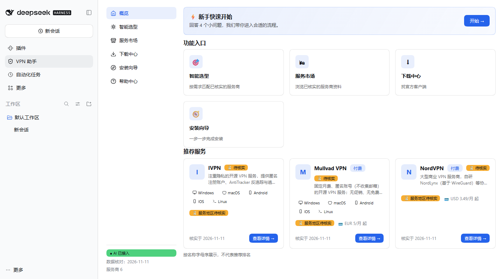

# DSH VPN Assistant

`dsh-vpn-assistant` is a DeepSeek Harness bundle for choosing a VPN service,
checking packaged provider facts, finding official download channels, following
an installation guide, and running opt-in read-only device/network diagnostics.

The plugin is designed for people who want a transparent recommendation process
instead of an unexplained ranking. Its rule engine exposes hard exclusions,
five scored dimensions, deductions, source dates, and a separate data-confidence
score. It never installs or connects a VPN.



## Features

- Six-provider catalog with sources, verification dates, and explicit unknowns.
- Deterministic six-question selector with five-dimensional scoring.
- Official-channel download guidance and a seven-step installation wizard.
- Nine DSH runtime skills grouped into selection, facts, installation, and troubleshooting.
- Page-context handoff to a native DSH session, with a copy fallback.
- User-authorized Windows helper for OS/client inventory and bounded DNS/TCP checks.
- Eight original instructional SVGs; no fabricated vendor screenshots.

## Compatibility

The independently tested combination is DeepSeek Harness `0.2.1-rc.5`,
Node.js 20 or newer, and the DSH `web` profile on Windows x64.

The package declares that exact DSH version rather than a wider untested range.
DSH Desktop runs the complete Web application in its reserved `desktop` profile,
but this release has not been independently verified in that profile. macOS/Linux
client inventory and mobile local-helper support are not claimed.

## Install

Install the public npm bundle into a Web profile:

```powershell
dsh plugin --profile web add dsh-vpn-assistant
```

Verify that the bundle layer is active, then start DSH:

```powershell
dsh --profile web --dump-config
dsh --profile web
```

The dump should contain a `dsh-vpn-assistant` layer and a `vpn-assistant`
plugin row. Restart the profile if it was already running. Open **VPN Assistant**
from the sidebar and start with **Smart selection** or **Service market**.

For DSH Desktop, use its Plugins UI when this package is present in a configured
index. A managed Desktop CLI may target the reserved profile with
`dsh plugin --profile desktop add dsh-vpn-assistant`, but that path remains
unverified in this release.

## Model and API key configuration

The deterministic selector, catalog, downloads, wizard, and local diagnostics do
not require a model API key. Native DSH answers use the model provider selected in
DSH. Configure provider credentials in DSH's own model/settings UI; never place a
key in this repository, this plugin's data files, or a diagnostic report. The
plugin does not read DSH credential files.

## Local-helper permissions and networking

Local checks are disabled until the user checks the disclosure and grants one
operation scope for ten minutes. The helper:

- reads Windows uninstall records and matching process names;
- reads the resolver's DNS server list;
- resolves one allowlisted hostname and may attempt a TCP 443 handshake;
- stores results only in the current page unless the user downloads the JSON;
- never reads VPN credentials, installs software, connects a VPN, or changes DNS,
  routes, registry values, or system settings.

The diagnostic targets are `example.com`, `www.microsoft.com`, and
`cloudflare.com`. Opening an official download link contacts the selected VPN
provider in a new tab. An optional DSH model response uses the user's configured
DSH provider and its normal network behavior.

## Upgrade and uninstall

```powershell
dsh plugin --profile web update dsh-vpn-assistant
dsh plugin --profile web remove dsh-vpn-assistant
```

Restart the profile after either operation. Removing the bundle removes its patch
layer and routes; it does not delete DSH sessions or change VPN/system settings.

## Troubleshooting

- **No sidebar entry:** run `dsh --profile web --dump-config`, confirm the bundle
  layer and plugin row, then restart the same profile.
- **DSH version rejected:** this release is declared only for `0.2.1-rc.5`.
- **Model unavailable:** catalog and rule-engine features continue in knowledge-base
  mode; configure the model in DSH itself.
- **Local helper unavailable:** use Windows x64, grant the requested scope, and retry.
- **No client detected:** portable installs, another Windows account, or unusual
  process names may be missed. Process detection does not prove VPN connectivity.

## Development and verification

```powershell
npm install
npm test
npm pack --dry-run
```

The release process also installs the generated tarball into an isolated DSH
profile, boots DSH, exercises the UI and helper, and verifies uninstall cleanup.
See `docs/FULL_TEST_REPORT.md` in the source repository for the recorded scope.

## Links and license

- Source: https://github.com/shudi729/dsh-vpn-assistant
- npm: https://www.npmjs.com/package/dsh-vpn-assistant
- Issues: https://github.com/shudi729/dsh-vpn-assistant/issues
- License: [MIT](LICENSE)
